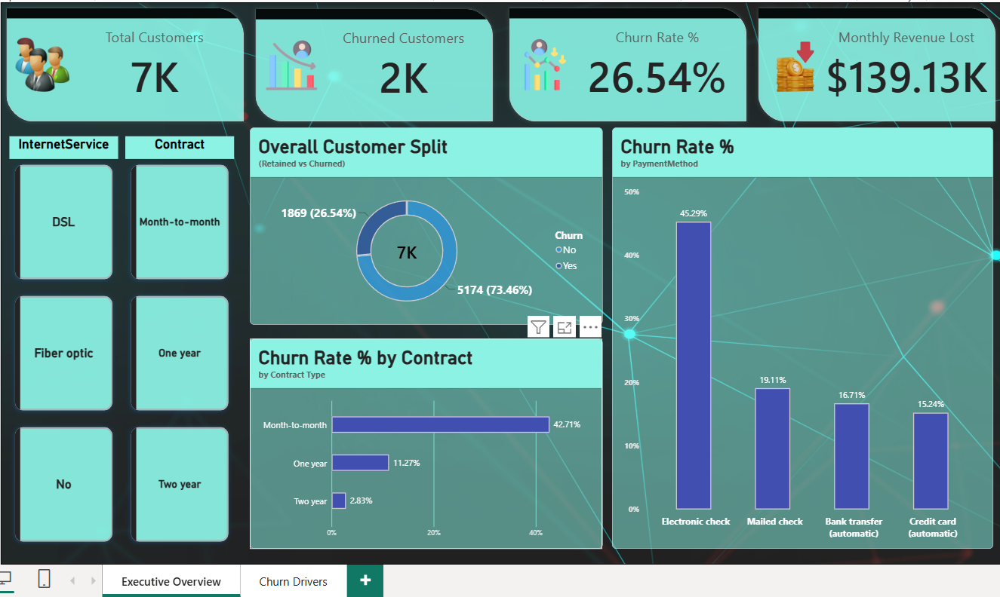
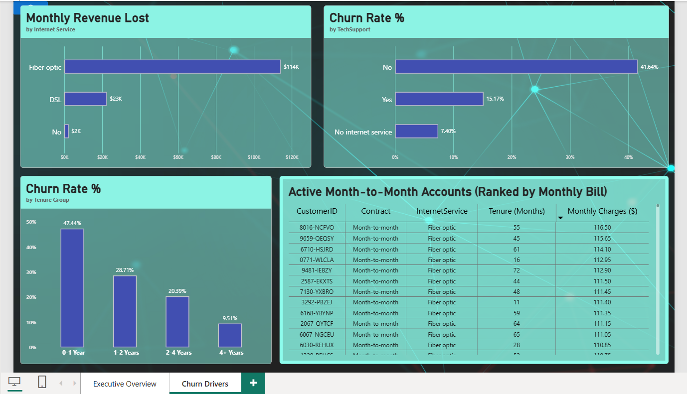

# Telecom Customer Churn Analysis (Excel · MySQL · Power BI)

> **TL;DR:** Analyzed **7,043 telecom customer records** across Excel, MySQL, and Power BI to diagnose churn drivers and revenue exposure. Found a **26.54% churn rate** (**1,869 accounts**, representing **$139,130.85** in snapshot monthly recurring revenue). Month-to-month contracts (**42.71%** churn), first-year tenure (**47.44%** churn), and Fiber optic plans (**41.89%** churn; **$114K** MRR lost) are the primary risk segments. Built a 2-page interactive Power BI dashboard with a prioritized retention outreach list—migrating just 10% of active month-to-month subscribers to 1-year plans is estimated to protect **~$4.3K in monthly recurring revenue**.

---

## 📌 Business Problem & Objective
Customer churn is one of the most critical revenue leaks in subscription-based telecom businesses, where acquiring a new subscriber is widely cited as costing **5–7× more** than retaining an existing one.

In this end-to-end analytics project, I audited and analyzed **7,043 customer accounts** to:
- Quantify overall churn and the monthly recurring revenue (MRR) tied to churned accounts in this snapshot.
- Identify the contractual, lifecycle, payment, and service-level factors most strongly associated with churn.
- Isolate high-value active subscribers at highest risk so retention teams can prioritize outreach.

---

## 🛠️ Tech Stack & Workflow
- **Microsoft Excel:** Data profiling, missing value imputation, categorical standardization, and duplicate auditing.
- **MySQL 8.0:** Exploratory Data Analysis (EDA), `CASE WHEN` conditional aggregations, window functions (`OVER ()`) for revenue-loss share, multi-variable confounder checks, and chronological tenure bucketing.
- **Power BI:** Custom DAX measures and calculated columns, interactive button slicers, and a 2-page executive report (`Executive Overview` & `Churn Drivers`).

---

## 📂 Repository Structure
- `WA_Fn-UseC_-Telco-Customer-Churn.csv` — Raw dataset (7,043 rows, 21 columns)
- `Telco_Churn_Cleaned.xlsx` — Cleaned Excel workbook
- `Telco_Churn_Cleaned.csv` — Cleaned CSV imported into MySQL
- `churn_queries.sql` — Documented MySQL queries (including window functions and confounder analysis)
- `Telco_Churn_Dashboard.pbix` — Interactive 2-page Power BI file
- `Telco_Churn_Dashboard.pdf` — Static PDF export of both dashboard pages
- `dashboard_page1_overview.png` — Dashboard Screenshot: Executive Overview
- `dashboard_page2_drivers.png` — Dashboard Screenshot: Churn Drivers & Actionable List

---

## 🧹 Data Cleaning & Quality Log (Excel)
Before running SQL queries or building visuals, the raw dataset was audited and cleaned:
1. **Missing Value Imputation:** Identified **11 blank spaces** in the `TotalCharges` column. Cross-checking showed all 11 records had `tenure = 0` (newly onboarded accounts not yet billed). Imputed these blanks with `0` rather than dropping valid customer records.
2. **Readability Standardization:** Converted `SeniorCitizen` values from binary (`0` / `1`) to descriptive labels (`No` — 5,901 records / `Yes` — 1,142 records) for clear reporting.
3. **Duplicate Audit:** Verified primary key integrity across `customerID` — **0 duplicate records** found across all 7,043 rows.

---

## 🔍 Key Analytical Findings (MySQL & Power BI)

| Metric / Segment | Key Finding | Business Implication |
| :--- | :--- | :--- |
| **Overall Churn & MRR Exposure** | **26.54%** churn rate (1,869 of 7,043 accounts) | **$139,130.85** in MRR tied to accounts flagged churned in this snapshot. |
| **Contract Type** | Month-to-month: **42.71%** vs. 1-Year: **11.27%** vs. 2-Year: **2.83%** | Month-to-month accounts churn at **15× the rate** of 2-year contracts and account for **~88.6%** of all churners (1,655 of 1,869). |
| **Customer Tenure** | `0–1 Year`: **47.44%** vs. `4+ Years`: **9.51%** | **55.5%** of all churned customers (1,037 of 1,869) leave within their first 12 months. |
| **Internet Service** | Fiber optic: **41.89%** ($91.50 avg bill) vs. DSL: **18.96%** ($58.10 avg bill) | Fiber optic users pay the highest bills yet churn at more than double the DSL rate, driving **~$114K** of the lost MRR. |
| **Payment Method** | Electronic check: **45.29%** vs. Auto-pay (Bank/Card): **15.24%–16.71%** | Manual payment methods are associated with nearly **3× higher churn** than automatic billing. |
| **Tech Support Add-On** | Without TechSupport: **41.64%** vs. With TechSupport: **15.17%** | Customers enrolled in `TechSupport` show substantially lower churn across contract segments. |

---

## 📐 Key DAX Measures (Power BI)
For reviewers viewing the PDF or screenshots without Power BI Desktop, core KPIs were built using the following DAX logic:

    Total Customers = COUNTROWS('WA_Fn-UseC_-Telco-Customer-Chur')

    Churned Customers = 
    CALCULATE(
        COUNTROWS('WA_Fn-UseC_-Telco-Customer-Chur'),
        'WA_Fn-UseC_-Telco-Customer-Chur'[Churn] = "Yes"
    )

    Churn Rate % = DIVIDE([Churned Customers], [Total Customers], 0)

    Monthly Revenue Lost = 
    CALCULATE(
        SUM('WA_Fn-UseC_-Telco-Customer-Chur'[MonthlyCharges]),
        'WA_Fn-UseC_-Telco-Customer-Chur'[Churn] = "Yes"
    )

    Total Customers Card = FORMAT([Total Customers], "#,0")
    Churned Customers Card = FORMAT([Churned Customers], "#,0")

---

## 📊 Power BI Dashboard

### Page 1: Executive Overview
*Executive KPIs (`Total Customers`, `Churned Customers`, `Churn Rate %`, `Monthly Revenue Lost`), interactive button slicers (`InternetService`, `Contract`), overall retention split, and churn rates by contract type and payment method.*

### Page 2: Churn Drivers & Actionable Retention List
*MRR lost by internet service (`$114K` in Fiber optic), churn rate by `TechSupport` and chronological `Tenure Group` buckets, and a prioritized table of active (`Churn = No`) Month-to-month customers sorted by highest monthly bill.*

---

## 💡 Quantified Business Recommendations
1. **Contract Migration Campaign (Highest ROI):** Target the **2,220 active Month-to-month subscribers** (representing **~$136.4K** in monthly revenue at high churn risk, prioritized in Page 2's outreach table) with a **10–15% loyalty discount** to upgrade to a 1-year contract. *Estimated Impact:* Migrating just **10%** of this segment (reducing their churn risk from 42.71% toward the 11.27% 1-year benchmark) protects **~$4.3K in MRR** (~$51K annualized, assuming retained cohort behavior holds).
2. **Structured 90-Day Onboarding Sequence:** Because **47.44%** of first-year subscribers churn, deploy proactive check-in calls at **Day 7, Day 30, and Day 90** paired with a 6-month tenure milestone reward.
3. **Auto-Pay Enrollment Incentive:** Offer a one-time **$5–$10 bill credit** to migrate Electronic check subscribers onto automatic bank transfer or credit card billing.
4. **Complimentary 3-Month TechSupport Trial:** Bundle free `TechSupport` for the first 90 days for new Fiber optic subscribers to address early setup friction and improve retention.

---

## ⚠️ Limitations & Analytical Caveats
- **Single Cross-Sectional Snapshot:** The dataset represents a point-in-time snapshot without historical timestamps or cohort join dates, preventing longitudinal survival modeling.
- **Correlation vs. Causation:** Observed patterns (such as lower churn among 2-year contracts or `TechSupport` users) reflect strong statistical associations rather than proven causal effects, as long-term subscribers are partially self-selected.
- **Missing Behavioral Context:** Network outage logs, customer support ticket counts, and competitor pricing data are unavailable and would further sharpen root-cause attribution.

---

## 📬 Contact & Links
- **Author:** Himansi Choudhary
- **GitHub:** [github.com/himansi-choudhary](https://github.com/himansi-choudhary)
- **Tools:** Microsoft Excel · MySQL · Power BI
- **Dataset Source:** [IBM Telco Customer Churn (Kaggle)](https://www.kaggle.com/datasets/blastchar/telco-customer-churn)
